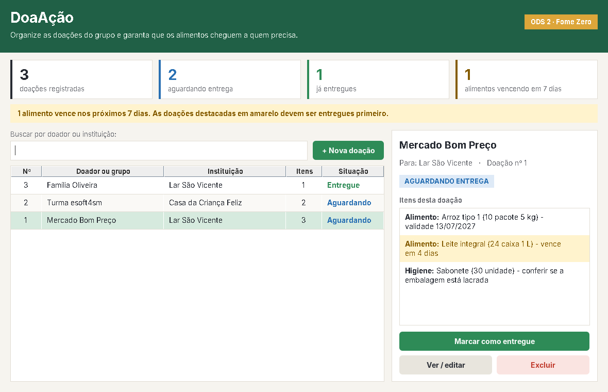

# DoaAção

**Unicesumar · Engenharia de Software · Turma esoft4sm**
AEP — 4º semestre — 2026.2 · Entrega 2 (código)

O DoaAção ajuda grupos solidários a organizar as doações que recebem: quem doou, o que veio, para qual instituição vai e se já foi entregue. O foco é a **ODS 2 — Fome Zero**: além de registrar, o sistema avisa quando um alimento está perto de vencer, para que ele seja entregue antes de se perder.

[Documento da AEP em PDF](docs/AEP_DoaAcao_Planejamento.pdf) · [Requisitos e planejamento](docs/Planejamento.md)



## O que o sistema faz

- **Cadastra doações** com o doador (pessoa, empresa ou grupo), a instituição que vai receber e um ou mais itens.
- **Separa alimentos e produtos de higiene.** Alimentos exigem validade; higiene não.
- **Consulta, edita e exclui** doações. A exclusão pede confirmação e remove os itens junto.
- **Acompanha a entrega**: cada doação fica *Aguardando* até alguém clicar em **Marcar como entregue**.
- **Painel de resumo** no topo: total de doações, quantas aguardam entrega, quantas já foram entregues e quantos alimentos vencem nos próximos 7 dias.
- **Alerta de validade**: doações com alimento vencendo em até 7 dias aparecem destacadas em amarelo, e cada item mostra "vence em 4 dias", "vence amanhã" ou "venceu em ..., confira antes de entregar".
- **Busca rápida** por doador ou instituição, que filtra a lista enquanto você digita.
- **Datas no formato brasileiro** (dd/mm/aaaa) e mensagens de erro que explicam o que corrigir.
- **Dados de exemplo**: com o banco vazio, o botão **Carregar exemplos** preenche algumas doações para conhecer o sistema.

## Como executar

Você precisa do **JDK 17 ou superior** (comandos `java` e `javac`) e de um computador com interface gráfica. Não é preciso instalar banco de dados nem ter internet.

Baixe o repositório (**Code → Download ZIP**) ou clone o projeto, e abra o terminal na pasta onde está este `README.md`.

**Windows**

```bat
compile.bat
run.bat
```

**Linux ou macOS**

```bash
bash compile.sh
bash run.sh
```

O script de compilação gera a pasta `bin`. Na primeira execução, o sistema cria o banco `data/doaacao.db` a partir de `database/schema.sql`. Para fazer uma cópia de segurança, feche o programa e copie esse arquivo.

## Como usar

1. Clique em **+ Nova doação** e informe quem está doando e para qual instituição vai.
2. Em cada item, escolha o tipo, descreva o que é, informe a quantidade e a unidade (pacote, caixa, kg...). Para alimentos, preencha a validade como `25/12/2026`. Clique em **+ Adicionar item**.
3. Clique em **Registrar doação**. Toda doação precisa de pelo menos um item.
4. Selecione uma doação na lista para ver os itens ao lado. Dali dá para **Marcar como entregue**, **Ver / editar** ou **Excluir**.
5. Use o campo de busca para encontrar uma doação pelo nome do doador ou da instituição.

## Organização do código

O código segue a separação em camadas vista em POO: modelo, acesso a dados (DAO), controle e tela.

```
src/br/com/doaacao/
├── App.java                     ponto de entrada (abre a tela ou roda os testes)
├── model/                       regras do domínio, sem Swing e sem SQL
│   ├── ItemDoacao.java          classe abstrata
│   ├── Alimento.java            herda de ItemDoacao
│   ├── Higiene.java             herda de ItemDoacao
│   ├── ItemDoacaoFactory.java   cria o item certo a partir do tipo
│   ├── Doacao.java              uma doação e seus itens (composição 1:N)
│   ├── Situacao.java            RECEBIDA / ENTREGUE
│   └── TipoItem.java            ALIMENTO / HIGIENE
├── dao/                         persistência com JDBC + SQLite
│   ├── DoacaoDAO.java           interface com as operações do CRUD
│   ├── DoacaoDAOSqlite.java     implementação com PreparedStatement e transações
│   ├── ConexaoFactory.java      cria o banco e entrega conexões
│   └── PersistenciaException.java
├── controller/
│   ├── DoacaoController.java    liga a tela ao DAO e ao modelo
│   └── ResumoDoacoes.java       números do painel de resumo
├── view/                        telas Swing
│   ├── TelaPrincipal.java       lista, busca, resumo e detalhes
│   ├── DialogoDoacao.java       cadastro e edição
│   └── Tema, Botao, CartaoResumo, DoacoesTableModel
└── teste/
    └── VerificacaoSistema.java  verificações automáticas
```

| Pasta | Conteúdo |
| --- | --- |
| `database/schema.sql` | Criação das tabelas, restrições e índice |
| `docs/` | Planejamento e PDF da AEP com diagramas |
| `lib/` | Driver SQLite JDBC e SLF4J |

As pastas `bin` e `data` são geradas na sua máquina e não vão para o GitHub.

## Onde estão os pilares de POO

| Pilar | Onde ver no código |
| --- | --- |
| **Abstração** | `ItemDoacao` é `abstract` e declara `getTipo()` e `resumo()` sem implementar. `DoacaoDAO` é uma `interface`. |
| **Encapsulamento** | Atributos `private` com validação no construtor: não existe item com quantidade zero nem alimento sem validade. |
| **Herança** | `Alimento extends ItemDoacao` e `Higiene extends ItemDoacao`. `DoacaoDAOSqlite implements DoacaoDAO`. |
| **Polimorfismo** | `resumo()`, `getValidade()` e `precisaDeAtencao()` têm `@Override` em `Alimento`. A tela e o controller trabalham só com `ItemDoacao` e cada objeto responde do seu jeito: o alimento fala da validade, a higiene lembra de conferir a embalagem. |
| **Composição** | Uma `Doacao` tem uma lista de `ItemDoacao`; no banco, `ON DELETE CASCADE` remove os itens com a doação. |

Nomes seguem CamelCase: classes com inicial maiúscula (`DoacaoController`), métodos e atributos com inicial minúscula (`marcarComoEntregue`).

## Banco de dados

SQLite acessado por JDBC. O script `database/schema.sql` cria duas tabelas:

- `doacoes` — doador, destino e situação (`RECEBIDA` ou `ENTREGUE`).
- `itens_doacao` — itens ligados a uma doação por `doacao_id`, com `tipo`, quantidade positiva e validade obrigatória só para alimentos.

O cadastro e a edição gravam a doação e os itens na mesma transação: se algo falhar, nada fica pela metade.

## Verificações automáticas

Depois de compilar, rode:

```bash
bash run.sh --test          # Linux ou macOS
```

```bat
java -cp "bin;lib/*" br.com.doaacao.App --test
```

São 17 verificações em um banco temporário (o seu `data/doaacao.db` não é tocado): cadastro, consulta, edição, entrega, exclusão em cascata, polimorfismo do `resumo()`, alerta de validade e recusa de dados inválidos, como quantidade zero, alimento sem validade e a data 31/02. A interação com as telas é conferida manualmente.

## Limites desta versão

Uso local, por um operador, sem login. Doador e instituição são campos de texto, sem cadastro próprio. Não há controle de estoque nem exportação de relatórios. O alerta de validade orienta a prioridade de entrega, mas a conferência dos produtos continua sendo manual.

## Dependências

- SQLite JDBC 3.46.1.0 (`org.xerial`)
- SLF4J API e NOP 2.0.13
- Swing e JDBC, que já vêm com o Java

Binários obtidos no Maven Central: [SQLite JDBC](https://repo.maven.apache.org/maven2/org/xerial/sqlite-jdbc/3.46.1.0/) e [SLF4J](https://repo.maven.apache.org/maven2/org/slf4j/).
